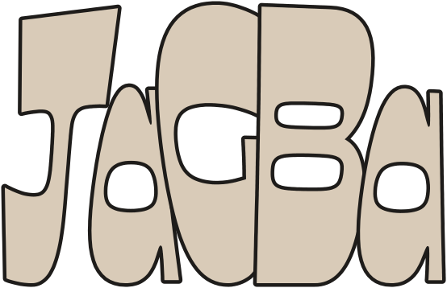

# JAGBA



Save just the part of a video you need, for research, teaching and quoting what was said.
Paste a YouTube, TikTok, Instagram, X or Vimeo link, or a link from any other site yt-dlp supports, then choose what to save:

- **Video**: the whole video, or only a clip. For a clip, JAGBA downloads just that section, not the whole video.
- **Audio**: MP3 or M4A, whole or clipped.
- **Transcript**: a `.txt` to read and quote, plus an `.srt` subtitle file. No video is downloaded.
- **Whole post**: every photo and video in an Instagram carousel or a TikTok photo slideshow, in slide order.

Video and Audio can also save a transcript alongside the file.
**Paste several…** takes many links at once, from any mix of sites.

**Download:** get `JAGBA-mac.zip` from the [latest release](../../releases/latest). The download page in `docs/` explains the install step by step.

## Install

1. Unzip `JAGBA-mac.zip` and drag **JAGBA** into Applications.
2. The first time you open it, macOS says it can't verify JAGBA, because it isn't from the App Store. Click **Done**.
   Then open System Settings › Privacy & Security, scroll down, click **Open Anyway**, enter your password and click **Open**. You only do this once.
3. On first launch JAGBA downloads yt-dlp. If the window offers **Install ffmpeg** or **Install Deno**, click them.
   ffmpeg cuts clips and prepares audio for transcripts. Deno is needed for YouTube.
4. For **Whole post**, click **Install gallery-dl** the first time. It's about 60 MB and is set up once, inside JAGBA's own folder.

Works on macOS 14 (Sonoma) or newer, on both Apple Silicon and Intel Macs. Transcripts are best on macOS 26 or newer.
JAGBA tells you when a newer version is out (Settings › JAGBA › Check for updates).

## Clips

- Drag the handles or type times (`1:23`, `1:02:03`). **⌘[** and **⌘]** set the in and out points to the playhead.
- **Zoom in** widens the timeline around your clip, which helps when you want 30 seconds out of an hour-long video.
- **Play clip** previews exactly what will be saved.
- A YouTube "Share at 1:23" link starts the clip at 1:23.

## Transcripts

1. **YouTube captions** are used first when the video has them. They're instant and need no audio download.
2. Otherwise the audio is transcribed **on your Mac** with Apple's built-in speech recognition. It's private and fast, and nothing needs installing.
3. **Whisper** (optional, in Settings): handles more languages, such as Yoruba, Hausa and Igbo, and strong accents.
   When it's installed, JAGBA uses it automatically for languages Apple doesn't support, and to detect the language when a video doesn't state one.

Set **Spoken language** under **Change** when you know it. "Detect automatically" uses what the site says. If the site says nothing, JAGBA uses Whisper if installed, and otherwise your Mac's language.

Each `.txt` starts with the title, link and clip times, so quotes are easy to cite.

## Logins (Instagram etc.)

Instagram, and some private or age-restricted videos, require you to be logged in.
Click **Change** above the download button and pick the browser where you're logged in, and its profile if it has several.

- **Only when needed.** Every link is tried without your login first. It's used for one retry only if the site asks, as Instagram usually does for private posts, carousels and stories.
- **Chrome and Safari** keep their logins in a place macOS protects. To use them, allow JAGBA under System Settings › Privacy & Security › **Full Disk Access**, then reopen JAGBA. That lets JAGBA and the tools it runs read all your files. Opera, Vivaldi and other browsers usually work without it.
- **When macOS asks** about "Chrome Safe Storage" (or another browser's), choose **Allow**, not **Always Allow**, so nothing can read your logins silently later.
- **A separate research account** is safest for heavy use, especially batch downloads from Instagram. Put it in its own browser profile and pick that profile in JAGBA.

## Privacy and security

- **JAGBA never asks for or sees your passwords.** The download tools read your browser's login cookies on your Mac and send each cookie only to the site it belongs to.
- **Nothing is sent anywhere else.** No accounts, analytics or server. Transcripts are made on your Mac. The only other request is the update check, which asks GitHub for the latest release.
- **What can read your logins:** yt-dlp loads all of the chosen browser's cookies while it runs. gallery-dl loads only the post's own site (for example instagram.com).
- **Every tool JAGBA downloads is checked** against its published SHA-256 checksum before it's installed, and refused if it doesn't match. That covers yt-dlp, ffmpeg, Deno and Python.
  - gallery-dl is installed with pip, which checks PyPI's published hashes. It installs only prebuilt packages, so nothing runs during installation.
  - yt-dlp checks its own updates.
  - These checksums catch corrupted or tampered downloads, not a hacked project. Keeping **Stable** as the update channel is the safer choice.
- **Instagram's rules don't allow automated downloading.** Heavy use can get an account rate-limited or temporarily blocked.

## When a site stops working

Sites change often, and these tools fix them often. JAGBA checks for new versions of yt-dlp and gallery-dl every day.
You can also click **Update** next to the yt-dlp version at the top of the window, or switch to the **Nightly** channel in Settings (⌘,). Nightly gets fixes sooner but is less tested.

## Building from source

Needs the Xcode command-line tools.

```
./build.sh               # builds build/JAGBA.app and build/JAGBA-<version>.zip
./tools/snapshots.sh     # draws every screen to build/screens/ with sample data
node tools/make-wordmark.js && ./tools/make-icon.sh   # regenerate the wordmark and icon
./tools/release.sh       # build and publish a GitHub release (needs the gh CLI)
```

`build.sh` signs with a code-signing certificate named "JAGBA Signing" if this Mac has one, so macOS permissions survive rebuilds; otherwise it signs ad hoc.
Set `JAGBA_REPO=owner/name` when building to turn on the update check.

Tools live in `~/Library/Application Support/JAGBA/bin`.
For testing: `JAGBA_YTDLP=/path/to/yt-dlp` uses a specific yt-dlp, `JAGBA_LOAD=<link>` loads a link at launch, `JAGBA_DIAG=1` reports which browsers' logins JAGBA can read, and `JAGBA_REPO=owner/name` overrides the update-check repository.

Fonts: [Ojuju](https://fonts.google.com/specimen/Ojuju) (wordmark) and [Courier Prime](https://fonts.google.com/specimen/Courier+Prime), both under the SIL Open Font License (see `Resources/Fonts`).

Please respect copyright and each platform's terms. JAGBA is meant for fair-use clips, such as quoting, research and teaching.
